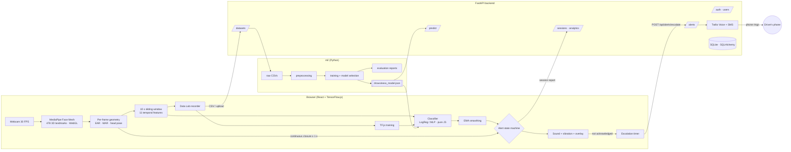

# System Architecture

DrowsiGuard AI is a **local-first** system: the entire perception and inference pipeline runs in
the browser, so it works offline and no video ever leaves the device. The backend adds accounts,
analytics, dataset collection, a server-side prediction API and **phone-call escalation**.

## Components

| Layer | Path | Responsibility |
|---|---|---|
| Routes / pages | `frontend/app/routes/` | Overview, Live Monitor, Analytics, Data Lab, Model Card, Login |
| Vision + ML engine | `frontend/hooks/useDrowsinessEngine.ts` | Frame loop, feature window, inference, status state machine, events, calibration, sessions |
| Feature engineering | `frontend/services/featureExtraction.ts`, `windowFeatures.ts` | EAR / MAR / head pose; PERCLOS, blinks, microsleeps, yawns |
| Inference | `frontend/services/classifier.ts` | Runs the portable model artifact + occlusion explanations |
| Training | `frontend/services/trainer.ts` | TF.js training, time-blocked split, metrics |
| Escalation | `frontend/hooks/useEscalation.ts`, `backend/app/api/alerts.py`, `backend/app/services/notifications.py` | Alarm → phone call ladder |
| API | `backend/app/api/` | REST endpoints (see [api.md](api.md)) |
| ML pipeline | `ml/` | Dataset building, model comparison, export, CNN (see [ml-report.md](ml-report.md)) |

## Shared contracts

* **Feature contract** — [`ml/feature_spec.json`](../ml/feature_spec.json) defines the 11 features and their order.
  The frontend imports it at build time, the backend reads it at start-up, and the ML pipeline uses it for column
  selection. A unit test asserts the bundled model, the spec and the synthetic generator agree.
* **Model artifact** — a small JSON file (scaler + dense layers). The same file is executed by
  `classifier.ts` (browser), `ml_service.py` (backend) and `ml/inference/predict.py`, so predictions are identical
  everywhere. `tests/ml/test_pipeline.py` verifies the export reproduces scikit-learn's probabilities to 1e-6.

## Alert state machine

| Condition | Status |
|---|---|
| No face for > 1 s | `no-face` |
| Continuous eye closure ≥ microsleep limit (default 1.0 s) **or** P ≥ critical threshold (0.85) | `critical` → alarm |
| P ≥ drowsy threshold (0.5) | `drowsy` |
| otherwise | `alert` |

The microsleep rule fires immediately (it does not wait for the 10 s window), while the classifier
captures slower fatigue patterns such as rising PERCLOS, slower blinks and yawning.

## Escalation ladder (wake-up guarantee)

1. **Visual** — full-screen red overlay.
2. **Sound** — pulsing 880 Hz square wave via Web Audio.
3. **Haptics** — `navigator.vibrate` pattern every 2.5 s (Android).
4. **Phone call** — if the alarm is not acknowledged within *N* seconds (default 8 s, user-configurable),
   the backend places a Twilio voice call to the driver's phone and SMSes an emergency contact.
   If the app detects that **neither sound nor vibration is working** (AudioContext suspended by autoplay
   policy, tab muted, no vibration motor), it escalates after 3 s instead.

An incoming call uses the phone's native ringtone and vibration, independent of browser permissions —
which is exactly the failure mode it is designed to cover. Calls are rate-limited per user (60 s cooldown)
and every attempt is logged in `alert_escalations`. Without Twilio credentials the server runs in
*simulated* mode and says so in the UI.

## Privacy

* Video frames are processed in memory in the browser and never transmitted.
* Only aggregate session metrics, labelled feature vectors (opt-in upload) and phone numbers (for escalation)
  are stored server-side.
* Passwords are hashed with bcrypt; API access uses short-lived JWTs.
