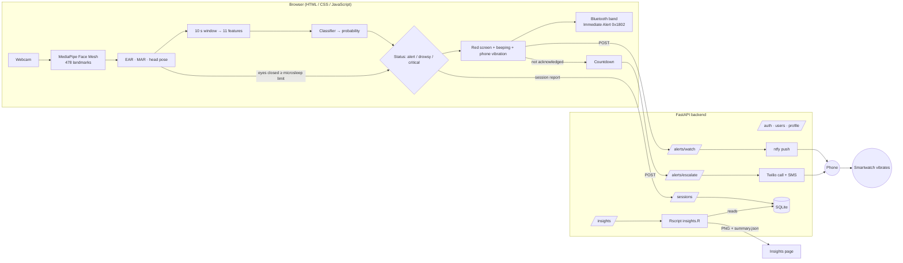

# System Architecture

The project has four parts:

1. **Website** (`frontend/`) — plain HTML, CSS and JavaScript. Face detection, feature extraction and the
   classifier all run in the browser, so the video never leaves the computer.
2. **Backend** (`backend/`) — Python FastAPI server. Serves the website, handles login and driver profiles,
   stores sessions in SQLite, sends smartwatch notifications and phone calls, and runs the R script.
3. **R analysis** (`r/insights.R`) — reads the sessions from the database, makes charts and runs statistical tests.
4. **ML pipeline** (`ml/`) — Python scripts to build a dataset, compare models and export the best one.

## Pages

| Page | Script | What it does |
|---|---|---|
| `login.html` | `js/pages/login.js` | Sign in / create account |
| `profile.html` | `js/pages/profile.js` | Driver type, vehicle number, smartwatch topic, phone-call settings |
| `monitor.html` | `js/pages/monitor.js` | Camera, live measurements, charts, alarm ladder, driver-type panel |
| `sessions.html` | `js/pages/sessions.js` | Saved sessions with charts and events |
| `insights.html` | `js/pages/insights.js` | Results of the R analysis |
| `training.html` | `js/pages/training.js` | Record examples, train a model, model details |

## JavaScript modules

| File | Purpose |
|---|---|
| `features.js` | EAR, MAR, head pose, the 11 window features, sliding window |
| `classifier.js` | Runs `models/drowsiness_model.json` and explains each prediction |
| `engine.js` | The detection loop: status, events (blinks, yawns, microsleeps, head nods), calibration, sessions |
| `detector.js` | Loads MediaPipe Face Mesh, starts the camera, draws the landmarks |
| `drivers.js` | Settings and screen layout for personal / cab / truck drivers |
| `alarm.js` | Beeping sound and phone vibration |
| `watch.js` | Smartwatch: Bluetooth Immediate Alert + ntfy notifications |
| `trainer.js`, `metrics.js`, `synthetic.js` | In-browser training and evaluation |
| `api.js`, `common.js` | Backend calls, login check, header, toasts |

## Driver types

| | Personal car | Cab / taxi | Truck |
|---|---|---|---|
| Microsleep limit | 1.0 s | 1.0 s | 0.8 s |
| "Drowsy" / alarm probability | 0.50 / 0.85 | 0.45 / 0.80 | 0.40 / 0.75 |
| Night (22–06) | – | 0.05 more sensitive | 0.05 more sensitive |
| Timer | trip time | shift time | continuous driving since last break |
| Breaks | suggested every 2 h | reminder every 2 h | compulsory 45 min after 4 h 30 min |
| Extra | – | passenger mode (quiet alarm, watch first) | alarms paused during break |
| Emergency contact | family member | cab company / family | fleet manager |

## Alarm ladder

1. Red full-screen alarm and beeping (Web Audio).
2. Phone vibration (Vibration API — Android only).
3. Smartwatch:
   - **ntfy notification** with priority 5. The phone shows it and the paired watch vibrates. This works with almost
     every smartwatch because watches mirror phone notifications.
   - **Bluetooth Immediate Alert** (service `0x1802`, characteristic `0x2A06`, level 2 = high alert) for bands that
     support it, connected with Web Bluetooth.
4. **Phone call** (Twilio) after the configured delay if "I'm awake" is not pressed, plus an SMS to the emergency
   contact. If no other channel works the call is made after 3 seconds. Calls are limited to one per minute.

## Shared files

* `ml/feature_spec.json` — the 11 features and their order (a test checks the JavaScript list matches).
* `frontend/models/drowsiness_model.json` — the classifier (scaler + layers). The browser, the API and
  `ml/inference/predict.py` all run this same file.

## Privacy

Video is processed only in the browser. The server stores session summaries, phone numbers (for the call), the
ntfy topic name and labelled feature values only if the user uploads them. Passwords are hashed with bcrypt.
